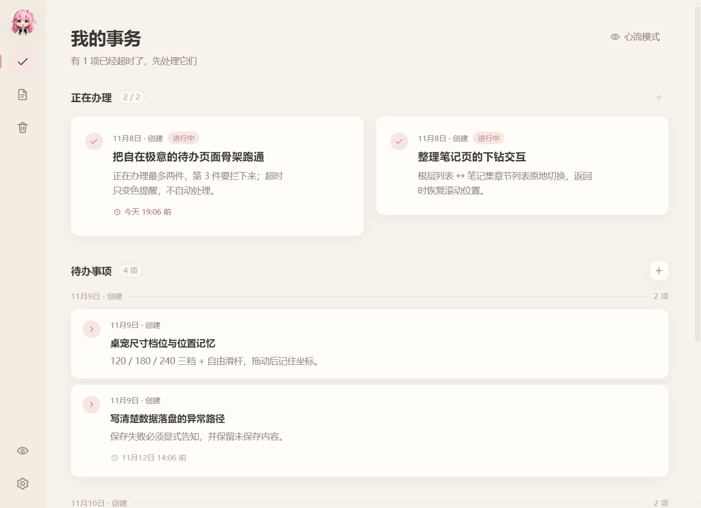
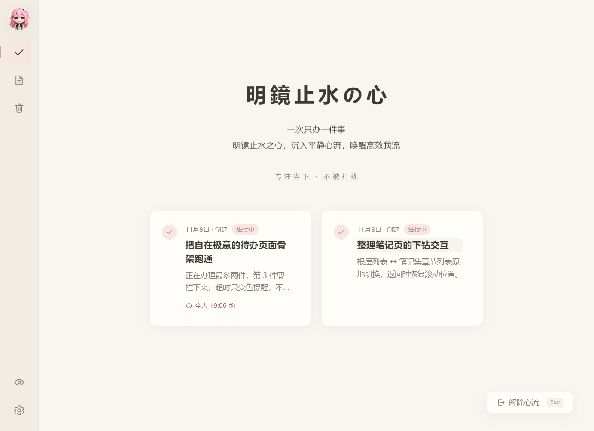
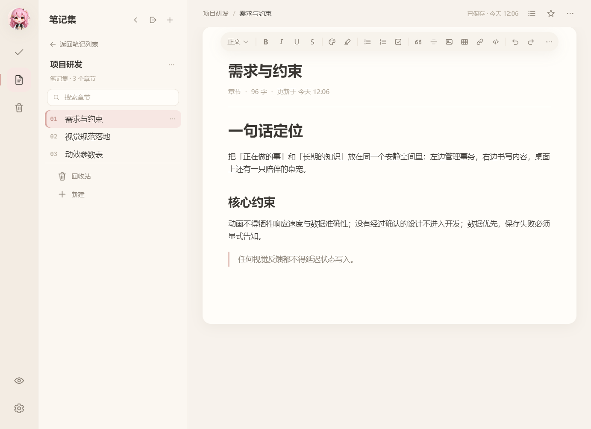
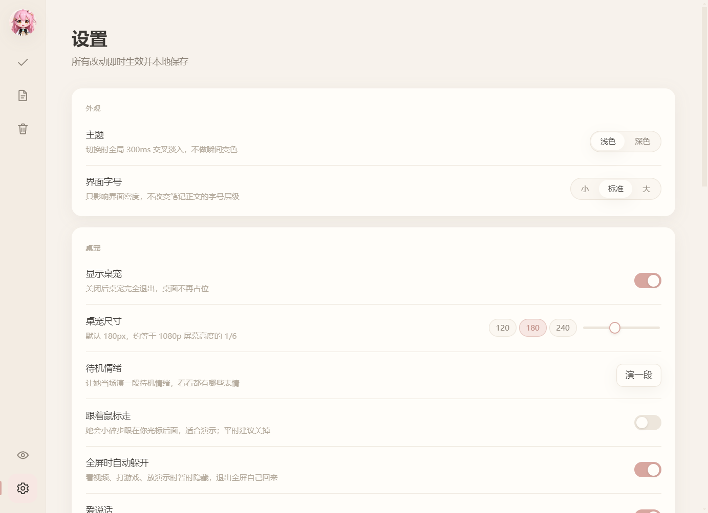

# 自在极意

> 把「正在做的事」和「长期的知识」放在同一个安静空间里，桌面上还有一只叫**小塔菲**的桌宠陪着你。/This is a software for managing to-do lists and notes, and it also has Ace Taffy as a pet on the desktop.

一个完全本地运行的 Windows 桌面应用：**待办 + 笔记 + 心流专注 + 桌面宠物**。
绿色版，解压即用，不写注册表、不需要账号、不联网上传任何数据。

| | |
| --- | --- |
| 适用平台 | Windows 10 / 11（64 位） |
| 分发形态 | 绿色目录版（zip 解压即用，约 104 MB） |
| 技术栈 | Electron 33 + 原生 JavaScript，无框架、无构建步骤 |
| 数据存储 | 本地 JSON，原子写入 + 每日自动备份 |


架构细节、全屏检测原理、鼠标穿透判定、调参表与自测说明见 [DEVELOPMENT.md](DEVELOPMENT.md)。

---

## 使用流程

1. **下载**：从仓库右侧 **Releases** 取最新的 `自在极意_v1.0.0_绿色版.zip`。
2. **解压**：把**整个文件夹**解压到任意位置（桌面、`D:\` 任意目录都行）。
   - 请勿只拷 `自在极意.exe` —— 它依赖同目录的 `resources\` 与各个 `.dll`；
   - 不建议放进 `C:\Program Files`（写数据可能没有权限）；
   - 路径带中文没有问题。
3. **启动**：双击 `自在极意.exe`。首次运行 Windows 可能提示「已保护你的电脑」，
   点 **更多信息 → 仍要运行**（未购买代码签名证书，属正常现象）。
4. **开始使用**：左侧窄栏切换「待办 / 笔记 / 回收站 / 设置」，底部两枚按钮控制桌宠显隐。
   - **待办**：点 `+` 新建，把任务拖进「正在办理」（同时最多 2 件），点圆圈完成；
     设了截止时间的任务超时只变色提醒，不会被自动处理。
   - **心流**：点右上角「心流模式」进入只留一件事的专注视图，按 `Esc` 退出。
   - **笔记**：新建笔记集 → 章节 → 正文，富文本自动保存；删除的内容进回收站，可整棵恢复。
   - **桌宠**：直接用鼠标拖着走，右键有菜单；全屏看视频、打游戏、放 PPT 时她会自动躲开。
5. **数据**：第一次运行会在程序文件夹内生成 `data\`，待办、笔记、设置都在其中。
   「设置 → 数据」可以更换目录、导出整份数据、从备份恢复或载入示例数据。
   **换电脑时把整个文件夹（含 `data\`）一起拷走即可**；删掉文件夹就等于卸载。
6. **退出**：关闭主窗口默认收进系统托盘（右下角），右键托盘图标选「退出」才真正结束。
   需要开机自启可在设置里打开。

---

## 功能概述

| 模块 | 能做什么 |
| --- | --- |
| **我的事务** | 正在办理（限量 2 件）、待办分组、拖拽排序、截止时间与超时提醒、快速完成 |
| **心流模式** | 一次只显示当前事情的专注视图，带过场动画；桌宠同步安静下来，`Esc` 退出 |
| **笔记集** | 笔记集 → 章节 → 文章三级下钻、富文本编辑、文章大纲、历史版本、收藏、搜索、回收站 |
| **桌面宠物** | 10 张情绪精灵图、随机漫游与台词气泡、举牌提醒、可拖拽、右键菜单、三档尺寸 + 自由滑杆 |
| **全屏让开** | 检测独占全屏 / 演示模式，自动收起桌宠，退出全屏后自己回来（可在设置里关闭） |
| **设置** | 浅色 / 深色主题、界面字号、桌宠行为、开机自启、数据目录与备份 |
| **数据安全** | 本地存储、原子写（先写 tmp 再 rename）、每日首次启动备份并保留最近 7 份、导出 / 恢复 |
| **窗口体验** | 单实例、尺寸与位置记忆、小窗口自适应（窄屏笔记列表收成抽屉）、托盘常驻 |



*主界面「我的事务」：左边是全局导航，右边把「正在办理」和「待办事项」放在一起，一眼看清今天该做什么。*

---

## 功能展示

### 心流模式：一次只做一件事

点「心流模式」后页面让位，只留下当前在办的事；桌宠会停止漫游和搭话，避免打断专注。
按 `Esc` 或点右下角「解除心流」返回。



### 笔记：三级下钻 + 富文本编辑

笔记集里再分章节，左侧列表可搜索、收藏、返回上一级；右侧是带工具栏的编辑器，
支持标题、加粗、列表、引用、代码、表格、链接与文章大纲，改动自动保存并保留历史版本。



### 桌面宠物：小塔菲

透明置顶窗口里的小塔菲会自己溜达、换表情、冒台词气泡，也能拖到桌面任意位置。
右键菜单可以换情绪、隐藏一会儿或退出；设置里能调尺寸、开关「跟着鼠标走」和「全屏时自动躲开」。


*桌宠窗口里实际渲染的角色与台词气泡（透明窗口在截图中显示为白底）。*

### 设置与数据

外观、桌宠、数据分组都在设置页，改动即时生效并本地保存。数据目录可以换到任意盘，
支持导出整份数据、从备份恢复、载入示例数据和清空全部数据。



---

## 实现要点

程序跑在**两个窗口**上：主窗口负责全部界面与数据；桌宠窗口是一块铺满屏幕的**透明置顶窗口**，
用 CSS `transform` 在窗口内移动角色，避免每帧移动 OS 窗口带来的掉帧。

鼠标穿透由主进程**单向判定**：页面只上报角色、气泡与菜单占的矩形，主进程读系统光标后
自己决定要不要关闭穿透 —— 没有「页面判定 → 回一个开关」的回环，因此她既不会挡住你在桌面上
点别的东西，也不会出现「看得见却抓不动」。全屏躲开、屏保唤醒、分辨率变化后都由主进程统一摆正窗口。

## 数据与隐私

- 所有内容只写在本机，没有账号、没有云端同步、没有任何统计上报。
- 写入是原子操作：先写 `.tmp` 并 `fsync`，旧版本留作 `.bak`，最后 `rename` 覆盖；
  断电最多丢最后一次写入，不会得到半截 JSON。
- 每天首次启动自动备份一份，保留最近 7 份；旧版本升级上来会沿用原目录，数据不会「消失」。
- 数据层同时预留了 SQLite 分支；默认使用零依赖的 JSON 后端，两者对上层接口一致。

## 本地开发

```bash
npm install                 # 只需一次，装 Electron 运行时
npm start                   # 开发模式启动
npx electron . --smoke      # 桌面端 56 项交互自测，结果写 _smoke.json
npx electron . --shots      # 重新生成 docs/screenshots/ 里的展示图
node tools/package.js       # 产出绿色版目录 release/自在极意/
```

浏览器端另有 `_selftest.html`（91 项），直接用浏览器打开即可运行，无需 Electron。
`--smoke` 和 `--shots` 都使用一次性数据目录，不会碰你的真实待办与笔记。

## 已知限制

- 目前只有 Windows 10 / 11 64 位版本；绿色版没有安装向导、开始菜单项和卸载条目。
- 桌宠窗口只铺主屏；全屏检测看的是前台窗口所在屏幕，副屏全屏也会让她收起。
- 首次运行会有 SmartScreen 提示（未做代码签名）；眨眼与瞳孔级视线跟随尚未实现。

---

## 文件目录

```
electron/
  main.js          主进程：两窗口、托盘、单实例、开机自启、IPC
  storage.js       数据层（SQLite 优先 / JSON 兜底，原子写 + 每日备份）
  preload-main.js  主窗口桥
  preload-pet.js   桌宠窗口桥
  fullscreen.js    全屏检测（Win32 / koffi）
index.html         主界面
pet.html           桌宠窗口（透明）
js/
  store.js         数据层（浏览器走 localStorage，桌面版走主进程）
  pet.js           桌宠全部行为，主窗口与桌宠窗口共用同一份
  pet-host.js      桌宠窗口的宿主层：Store/UI 桩 + 鼠标命中检测
  pet-boot.js      桌宠窗口启动
  pet-proxy.js     主窗口里的转发器：把 Pet.xxx() 送到桌宠窗口执行
  todo.js notes.js settings.js ui.js util.js app.js
css/               主题 token + 各页面样式
assets/pet/        桌宠 10 张精灵图（326×583，脚底对齐）
assets/icon/       应用与托盘图标
tools/package.js   打包脚本
tools/diag-idle.js 开发诊断：真实鼠标点击验证桌宠长期可操作（不进发布包）
tools/shots.js     生成 README 展示图（`--shots`，不进发布包）
docs/screenshots/  README 中的 5 张功能截图
DEVELOPMENT.md     架构与实现细节、自测说明、调参表
_selftest.html     浏览器端自测（91 项）
```
